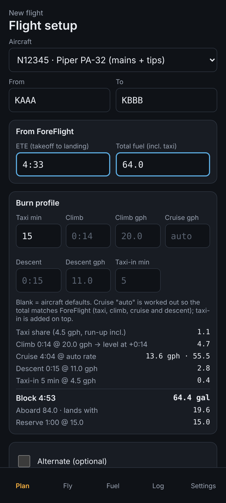
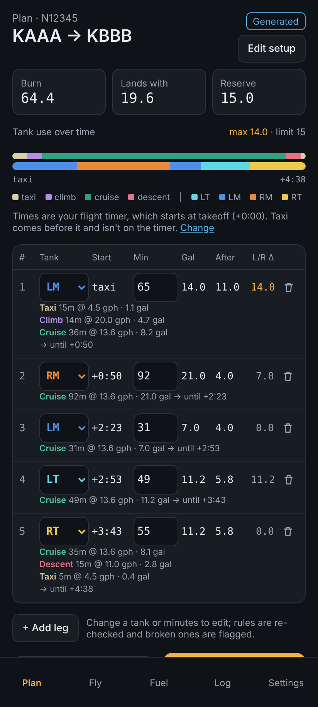
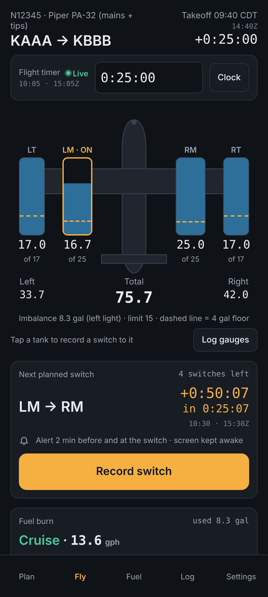
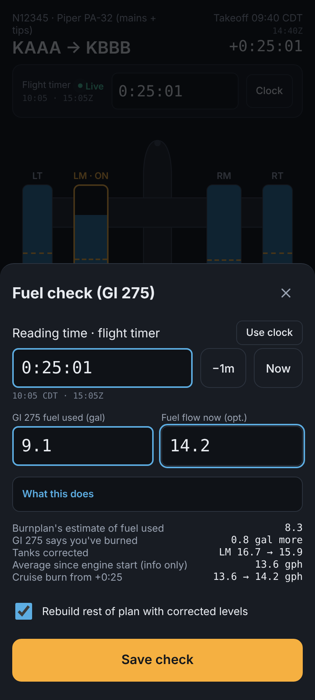

# Burnplan

Fuel tank switching planner and in-flight tracker for piston aircraft with more than one tank.

Open it at https://austinbeam.github.io/burnplan/. It runs in your phone's browser, installs like an app and works with no signal.

| Set up | Plan | Fly | Fuel check |
| --- | --- | --- | --- |
|  |  |  |  |

*Screenshots use sample data: tail N12345, a made-up route from KAAA to KBBB.*

## What it does

- **Plan**: type in ForeFlight's ETE and total fuel. Burnplan builds a tank switching plan with the longest legs that keep every tank above its floor, keep the sides within the imbalance limit and land with your reserve.
- **Fly**: shows the live tank levels, the next planned switch and when it's due. You record what actually happens (switches, climbs, descents, engine monitor readings, new ETEs) and the estimate and plan follow along.
- **Fuel**: records fuelings tank by tank from the pump readings (or just the total, if you weren't there), and fills in the next flight's starting fuel.
- **Log**: keeps every flight with its plan next to what really happened, so you can see how your planning compares over time.

Burnplan is a planning aid, not an approved fuel management system. Always check the aircraft's gauges, engine monitor and POH.

## Install on your phone

1. Open the link above in Chrome (Android) or Safari (iPhone).
2. Chrome: **⋮ → Add to Home screen** (or **Install app**). Safari: **Share → Add to Home Screen**.
3. Open it once while you have a connection. After that it works offline.

Updates download on their own the next time you open the app with a connection. The version number is at the bottom of Settings.

## First time: add your aircraft

On first open Burnplan asks for your aircraft.

1. Pick the **type**. Built-in types include the PA-32 (mains and tips), Cessna 172, 182, 206H and 210, PA-28 Warrior, Archer and Arrow, Saratoga, A36 Bonanza, SR22 and M20J.
2. Enter the **tail number**.
3. Confirm the **cruise fuel burn** (gph). It's prefilled from the type. Change it if your airplane burns differently.

The type gives the tanks, burn profile and rules. You can change any of them for your own tail later: tap the tail under **Settings → Your aircraft**. If your type isn't listed, copy a similar one under **Settings → Aircraft types** to make your own, or tap **Request an aircraft type**.

## Plan a flight

1. On **Plan**, pick the aircraft and enter From and To.
2. From ForeFlight, enter the **ETE** (takeoff to landing) and the **total fuel** (including taxi).
3. Check the starting fuel in each tank. It's filled in from your last fueling or last flight.
4. Optionally adjust taxi, climb, descent or cruise gph, or add an alternate.
5. Tap **Build plan**.

The plan shows each leg: which tank, when it starts, how long it runs, fuel burned, what's left in the tank, and the left/right imbalance. The colored bar shows the whole flight at a glance.

You can edit any leg: change the tank, the minutes, or the gallons the tank should have left after it (**After**), and the other is calculated. Tap a leg's number to keep the plan through that leg and rebuild everything after it, for example to lock in the next switch and rebalance the rest. Broken rules are flagged in orange or red, but never blocked; you're the pilot. **Regenerate** goes back to a fresh plan.

### How the plan is built

- **Floor**: no tank is planned below its floor (4 gal by default).
- **Balance**: the sides are burned evenly and kept within the imbalance limit (15 gal on the PA-32).
- **Long legs**: legs are made as long as the rules allow, so you switch as rarely as possible.
- **Reserve**: you land with at least the reserve (60 minutes at cruise burn by default) plus any alternate fuel.
- **Timeline**: taxi, climb, cruise, descent, then taxi-in. ForeFlight's fuel includes taxi, and Burnplan works out the cruise burn so the total matches. Taxi-in is added on top.

On types with a BOTH selector position (the 172, 182 and 206H) the plan runs on Both, and Both appears as a choice in the tank pickers.

## In flight

Tap **Start flight** on the Plan page. Enter the flight timer reading (h:mm:ss, colons are added for you). By default the timer reads 0:00:00 at **takeoff**, like a GTX 345. You can change that to engine start in **Settings → Flight timer**.

The **Fly** page shows:

- the four (or two) tanks with live estimated levels, and the floor as a dashed line,
- the next planned switch, a countdown, and alerts 2 minutes before and at the switch (the screen stays on),
- the current burn rate and fuel used,
- your arrival time and what you'll land with.

Record things as they happen. Every entry asks for the time it happened, so you can catch up later if you're busy.

| Button | Use it when |
| --- | --- |
| **Record switch** (or tap a tank) | You switch tanks. |
| **Climb** / **Level off** | You start or finish a climb. Climbs are flown on one tank. |
| **Descend** / **Level off** | You start a descent, including stepped descents with their own burn rates. |
| **GI 275** | You read fuel used from the engine monitor (see below). |
| **Set burn** | You lean or change power and want a new cruise gph. |
| **Update ETE** | ForeFlight's ETE changes, or you divert to a fuel stop. |
| **Log gauges** | You want to note the panel gauge readings (for calibration only). |
| **Landed**, **End flight** | You land, then shut down. |

### Engine monitor fuel checks

The engine monitor's "fuel used" figure is treated as correct. Any difference from Burnplan's estimate goes **to climb first** (the least certain part of the estimate), and only what's left is spread over the rest of the flight. If you also type in the current fuel flow, that becomes the cruise burn from then on. You can rebuild the rest of the plan with the corrected levels in the same step.

### Cruise burn is never guessed

Burnplan only changes your cruise burn when you tell it to: with **Set burn**, a fuel flow typed into a fuel check, or a gph typed into **Update ETE**. It never works a burn rate out of fuel used or ForeFlight's fuel figures.

### Viewing another moment

Type a time into the flight timer box on the Fly page to see the tanks at that moment. Alerts still run on real time, and **Go live** returns to now.

## Fuel tab

Record a fueling at the pump: top off, specific amounts, or tips full with the mains to the tabs. Enter the **cumulative** pump reading after each tank, in the order you fill them, and Burnplan works out each tank. The next flight starts with those levels. Optional gauge readings help you learn how your gauges read; they never change any calculation.

If you weren't there to see each tank filled, switch to **Total only** and type the total gallons added. On a top-off or tabs fill, each tank is set to its target, and Burnplan compares the total with what it calculated the tanks needed. That difference, and its share of the calculated burn since the last fueling, shows how close your burn estimate is. It's for your information only: Burnplan never changes your cruise burn from it. With specific amounts, the total is only checked against what you asked for.

## Log

Every flight is kept with its plan, every plan change and every recorded event. Open a flight to see the plan beside what actually happened, edit its history, or export it. Ended flights can be reactivated if you ended them too early.

## Your data

Everything stays on your phone. There's no account, no server and no analytics.

- **Settings → Backup → Export backup** saves a file with all your flights, aircraft and settings. Keep a copy, or use it to move to a new phone.
- **Import** reads a backup, flight, tail or type file. Imports are merged and never delete anything.
- Clearing your browser's site data deletes everything, so export a backup first.

## Guide in the app

This page is built into the app, so it's there offline too. Open it from **Guide** at the top of the Plan page.

## For developers

No build step and no dependencies: plain JavaScript modules and a service worker.

```
python3 -m http.server          # then open http://localhost:8000
node --test test/planner.test.mjs   # planner tests
test/ui/run.sh                      # planner tests plus the Playwright UI scripts
python3 docs/shots.py               # regenerate the README screenshots (sample data)
```

- `js/planner.js` is the planning and estimation logic (no DOM, unit tested). `js/app.js` is the UI, `js/store.js` the on-device storage, `js/types.js` the built-in aircraft types.
- Pushing to `main` runs the tests and deploys to GitHub Pages.
- When you change app files, bump `APP_VERSION` in `js/app.js` and `VERSION` in `sw.js` so installed copies update.
- This repo is public. Use sample data (like tail N12345) in tests, docs and screenshots, never a real registration.

`CLAUDE.md` has the full set of design rules and the data model.
